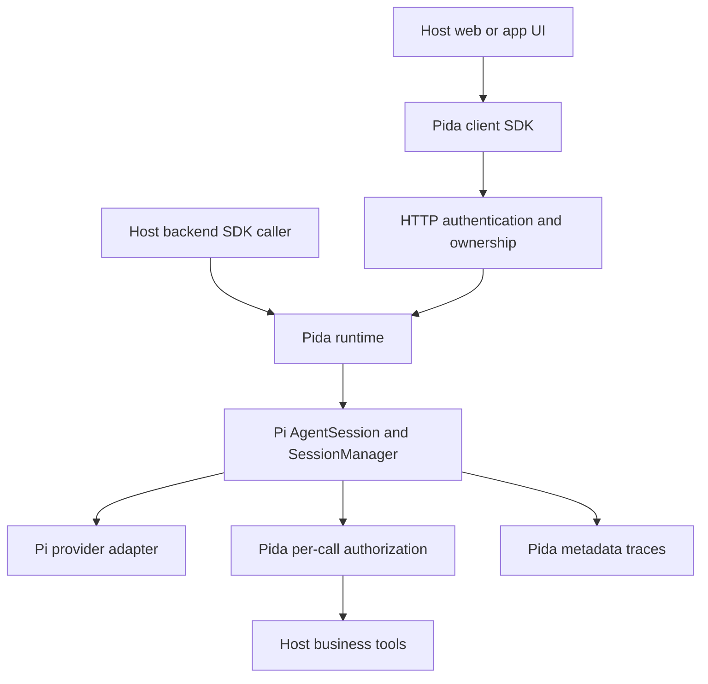

# Architecture decision — Pida-core 0.1

2026-10-14. Implements the user's Pida Initial Engineering Task, superseding the OpenCode-first assumption of the attached July Schumpeter baseline for this repository only.

## Boundaries

- Pi owns its iterative loop, typed model messages, tool schema validation/dispatch, conversation projection, session tree and streaming.
- Pida owns application principals, session owner lookup, run exclusivity, limits, per-call authorization, sanitized lifecycle traces and HTTP/client transport.
- The host owns authentication, business/resource permissions, credentials, provider choice, domain tool implementation and UI.
- No OpenCode/Codex process or API is involved. `pi-coding-agent` is embedded as a library; its CLI is never invoked.

## Reuse decision

Use `createAgentSession`, not a new agent loop. Use `SessionManager.inMemory`, not a competing message store. Pida's Map indexes ownership and active handles; it is not an alternate transcript engine. Wrap Pi's `prepareRequest` and `finishTurn` hooks while preserving their original implementations, so canonical projection and session boundary processing remain Pi-owned.

`pi-agent-core` alone would require host session persistence/context work; the coding-agent SDK already implements these contracts. It does bring CLI/TUI-related transitive dependencies. Accept that footprint for MVP rather than deep-importing internal files or copying the loop. Reassess if the package size or startup cost becomes material, using measurements.

## Application portability

- Install the npm tarball in an existing Node backend and embed `PidaRuntime` directly.
- Alternatively run one Pida HTTP service and call it from multiple frontends.
- Import only `pida-core/client` in browser bundles; it has no runtime imports of Node or Pi.
- The plain-JS example imports the same compiled client SDK that consumers receive.
- Desktop apps can use a local Node backend or a remote service. Native mobile apps use the HTTP/SSE contract; no native mobile runtime or platform packaging was tested.

## Narrow first profile

No general shell, browser automation, MCP auto-discovery, skills loader, scheduler, background task manager or multi-agent orchestration is enabled. These are explicit future profiles with their own authorization requirements, not claims of missing Pi capabilities. No OCEL/PIX integration is claimed: current trace metadata is an integration point, not an OCEL-conformant ledger.

Sessions and traces are process-local. Persistent reopening, multi-worker ownership, recovery after process failure, replayable SSE and exactly-once execution need a separate milestone. Reuse Pi's persistent session contracts when adding them, and keep application identity metadata in a durable host index. Do not implement a second Pi session format.

## Acceptance / withdrawal conditions

The present design is valid for an embedded, single-process MVP with trusted host code and cooperative tools. Reassess on a Pi dependency update or before remote multi-user deployment. Withdraw readiness if unauthorized calls execute, session history crosses users, cancellation is reported before settlement, package consumers need to implement a loop, or Pi projection is bypassed. There is no throughput, availability, sandbox or enterprise production claim.
