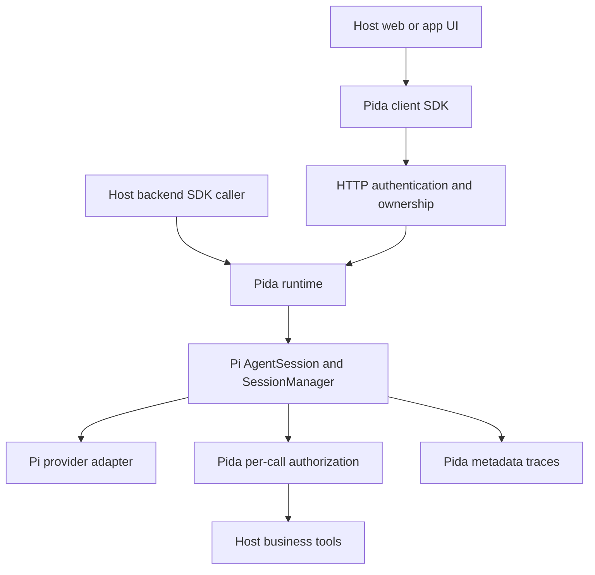

# Architecture decision — Pida-core 0.2

Updated 2026-10-15 KST. Implements the user's Pida Initial Engineering Task, superseding the OpenCode-first assumption of the attached July Schumpeter baseline for this repository only.

## Boundaries

- Pi owns its iterative loop, typed model messages, tool schema validation/dispatch, conversation projection, session tree and streaming.
- Pida owns application principals, session owner lookup, run exclusivity, limits, per-call authorization, sanitized lifecycle traces and HTTP/client transport.
- The host owns authentication, business/resource permissions, credentials, provider choice, domain tool implementation and UI.
- No OpenCode/Codex process or API is involved. `pi-coding-agent` is embedded as a library; its CLI is never invoked.

## Reuse decision

Use `createAgentSession`, not a new agent loop. Use Pi `SessionManager.inMemory` for ephemeral embedding and `SessionManager.create/open` for persistent workspaces, not a competing message store. Pida's Map indexes ownership and active handles; it is not an alternate transcript engine. Wrap Pi's `prepareRequest` and `finishTurn` hooks while preserving their original implementations, so canonical projection and session boundary processing remain Pi-owned.

`pi-agent-core` alone would require host session persistence/context work; the coding-agent SDK already implements these contracts. It does bring CLI/TUI-related transitive dependencies. Accept that footprint for MVP rather than deep-importing internal files or copying the loop. Reassess if the package size or startup cost becomes material, using measurements.

## Application portability

- Install the npm tarball in an existing Node backend and embed `PidaRuntime` directly.
- Alternatively run one Pida HTTP service and call it from multiple frontends.
- Import only `pida-core/client` in browser bundles; it has no runtime imports of Node or Pi.
- The plain-JS example imports the same compiled client SDK that consumers receive.
- Desktop apps can use a local Node backend or a remote service. Native mobile apps use the HTTP/SSE contract; no native mobile runtime or platform packaging was tested.

## Narrow first profile

No general shell, browser automation, MCP auto-discovery, skills loader, scheduler, background task manager or multi-agent orchestration is enabled. These are explicit future profiles with their own authorization requirements, not claims of missing Pi capabilities. No OCEL/PIX integration is claimed: current trace metadata is an integration point, not an OCEL-conformant ledger.

## Workspace layer

`pida init` creates `pida.config.json`, private `.env`, and a `tools/` folder. `pida configure` edits non-secret provider configuration interactively. `pida start` uses `createWorkspace()` to compose the same runtime, HTTP adapter and client UI; applications may also import that function or use the lower-level SDK. `doctor` is a static configuration/path check and deliberately does not import tool code or make model requests.

Tool files are deployer-trusted ESM modules, explicitly enabled by basename. Directory traversal and file/directory symlinks escaping the tool workspace are rejected. Permission grants remain separate from module selection. Tool configuration is read at startup; hot reload is not implemented.

`storage.ts` keeps a per-session atomic JSON metadata file with owner, title, timestamps, run budget, bounded metadata traces and the Pi filename. The canonical transcript remains Pi JSONL. Saved sessions are loaded lazily after ownership validation; historical permissions are not restored. New model configuration and tool selection apply when a session is reopened. Credentials are not stored in the metadata.

A filesystem lock allows one process per state directory. Shutdown cancels active cooperative work and releases the lock while preserving sessions. An abrupt termination leaves a lock for explicit `pida unlock` recovery; the command refuses a live or unverifiable owner. Interrupted runs are surfaced as interrupted and never automatically retried. Conversation/metadata writes are not one transactional commit, and no power-loss durability or exactly-once tool execution is claimed.

The web UI uses the same `PidaClient` to list conversations, select/resume them, stream text, show traces and cancel/delete. It displays configured model information, not a model-connectivity health check. Local browser launch passes the application token in a URL fragment, which is removed immediately; tokens are not saved in local/session storage. Manual token login remains available.

## Acceptance / withdrawal conditions

The present design is valid for an embedded, single-process MVP with trusted host code and cooperative tools. Reassess on a Pi dependency update or before remote multi-user deployment. Withdraw readiness if unauthorized calls execute, session history crosses users, cancellation is reported before settlement, package consumers need to implement a loop, or Pi projection is bypassed. There is no throughput, availability, sandbox or enterprise production claim.
