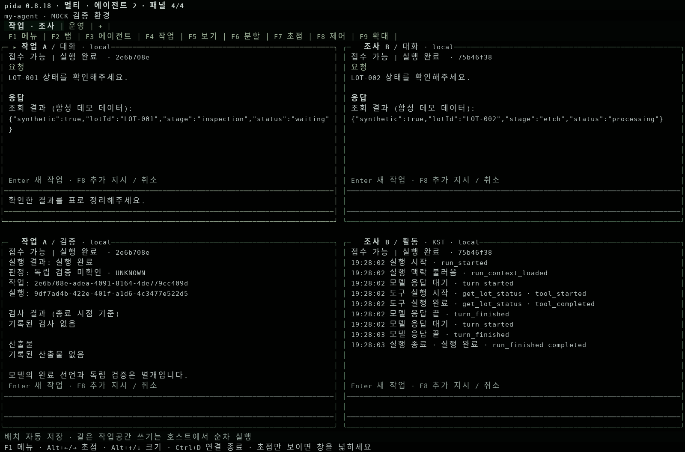
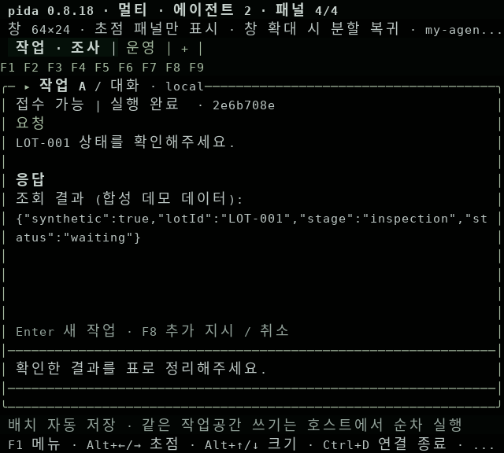

# Pida 0.8.18 — WMC 화면 수용 및 감사 지적 수정

2026-11-05 · 대상: `ux/templeos-display-compare` / PR #2

WMC의 어두운 녹색 색상, 명확한 패널 외곽선, 단계별 메뉴 축약, 한국어 실행 상태, 빈 화면 안내, Web 글자 크기를 유지했다. 그 위에 저장·관측·입력 재전송·표시·상태 복원 오류를 수정했다. 실행 루프와 대화 직렬화는 기존 Pi 구현을 사용한다.

검토 기준은 0.8.17 `c22fb3d71646c273ef64cd6d8ca75c207fda147c`를 대상으로 한 2026-11-05 하네스 감사보고서와 TempleOS 관점 통합 보고서다. WMC 표시 변경의 기준 커밋은 `1edfe4e89ad0252758c6e6a1d8ecd1e7c3811a82`다. 이 문서는 원본 보고서 전체의 완료 선언이 아니다.

## 하네스 감사 대응

| 지적 | 0.8.18 처리 | 남는 경계 |
| --- | --- | --- |
| H-01 세션 인덱스 fsync 누락 | `savePrivate`를 재사용해 임시 파일 fsync 후 rename. 실패하면 이전 파일·메모리 값을 유지하고 임시 파일 제거. 사라진 인덱스 디렉터리는 조용히 재생성하지 않음 | 디렉터리 fsync·Pi transcript와의 다중 파일 트랜잭션·실제 정전 내구성은 보장하지 않음 |
| H-02 관측 손실 원인 합쳐짐 | 손상·보관 한도·I/O·manifest 실패를 별도 코드로 보존. 기존 `OBSERVATION_INCOMPLETE` 유지. 건강 상태 파일로 재시작 후에도 원인 조회. 저장된 event/manifest는 기존 계약 스키마로 검사 | 저장 장치 전체 장애는 진단 파일 저장도 막을 수 있음 |
| H-03 추가 지시 재전송 계약 없음 | 선택적 `requestId`, 같은 요청의 최초 응답 재사용, 본문·모드 충돌 거절. SDK는 응답이 불명확한 동일 입력의 명시적 재전송에 같은 ID 사용 | `durable: false`. 서버/클라이언트 재시작에 걸친 영속 입력 큐는 아님. 자동 재전송 없음 |
| H-04 호스트 셸의 격리 경계 | `/v1/info`에서 설정된 한계를 제공하고 Web 연결 화면·명령 패널·단일 TUI 도구 보기에서 OS 격리 부재 표시 | OS 샌드박스 실행기는 아직 없음. 기존 trusted-host 설정과 권한 검사 유지 |
| H-05 취소가 협력적임 | capability에 `cancellation: cooperative` 명시. 중단 요청과 프로세스 종료의 구분 유지 | AbortSignal을 무시하는 도구를 강제 정지하는 worker/process 격리는 후속 설계 |
| H-06 관측 JSONL fsync 누락 | 각 JSONL append 후 실제 파일 descriptor fsync. 실패해도 실행을 취소하지 않고 관측 불완전 표시 | 동기 저장 비용이 늘 수 있음. 처리량·정전 시험은 수행하지 않음 |
| H-07 관찰 화면 1초 폴링 | 단일 TUI의 기존 SSE `text_delta`를 즉시 표시하고 trace는 `afterSequence`로 증분 조회 | 별도 읽기 전용 관찰 SSE, 멀티 에이전트 push 전환은 미구현 |
| H-08 버전 불일치 | 패키지·잠금파일·현재 사용가이드 0.8.18. Web 버전은 인증된 실제 서버 응답에서 표시 | 과거 버전별 검증 문서는 역사 기록으로 유지 |
| H-09 내부 모델 호출의 사용량 범위 | `tokenBudgetScope: observed-model-responses` 및 기존 `PI_INTERNAL_REQUEST_USAGE_NOT_EXPORTED`를 discovery에도 명시 | Pi 내부 압축 호출까지 포함한 총 사용량·과금 상한은 미구현 |
| H-10 외부 실연동 시험 | 로컬 결정적 테스트와 외부 실연동 미실행을 구분해서 기록 | 실제 LLM·회사 게이트웨이·외부 PIX·Windows IME는 별도 검증 필요 |

## 화면·인터페이스에서 추가 수정한 오류

- KST 날짜를 일자 숫자만으로 비교하던 문제를 수정했다. 다른 달·연도의 같은 일자는 오늘로 표시하지 않는다. 전년도 기록은 연도도 표시한다. 숫자형 `deadlineAt`은 Unix epoch 밀리초로 처리한다.
- 좁은 메뉴의 `…F1`을 눌렀을 때 숨겨진 다른 버튼이 실행되던 문제를 수정했다. 표시된 범위만 클릭 가능하며, 탭의 넘침 표시는 `…F2`로 탭 메뉴를 연다. 한글의 화면 셀 너비를 반영한다.
- 상태·시간 함수를 `src/display.ts`로 모았다. Web의 전역 변수 초기화 순서 의존과 TUI/컨트롤러의 복사본을 제거했다. 브라우저에 제공되는 정적 모듈 허용 목록도 함께 갱신했다.
- 단일 TUI에서 직접 시작한 실행의 응답은 SSE로 즉시 보인다. 폴링은 재접속·다른 클라이언트의 실행 관찰을 위해 유지한다. 이전 HTTP 스냅샷이 새 스트리밍 텍스트를 덮지 않도록 했다.
- 저장된 조직 합류 결과의 assignment·attempt·job·owner·run·상태·입력/결과 해시를 검증한다. 잘못된 참조는 `ORG_STATE_INVALID`로 복원을 거절하며 원본 상태 파일을 보존한다.
- 멀티 에이전트 브라우저 검사에서 이전 취소 문구를 기다리던 조건을 갱신하고 CI에 추가했다. Playwright가 설치한 Chromium을 기본 사용하고 지정 실행 경로도 지원한다.

## 관측 진단 코드

`known_limits`는 기존 불완전 표시와 함께 아래 원인을 포함할 수 있다. 원문 오류·경로·프롬프트는 진단 코드에 넣지 않는다.

| 코드 | 의미 |
| --- | --- |
| `OBSERVATION_ARCHIVE_CORRUPT` | JSON·스키마·순서·digest 또는 관측 identity가 손상됨 |
| `OBSERVATION_ARCHIVE_LIMIT` | 설정된 event 개수 또는 16 MiB 보관 한도 초과 |
| `OBSERVATION_ARCHIVE_IO` | 관측 읽기·쓰기·fsync 또는 상태 기록의 I/O 실패 |
| `OBSERVATION_MANIFEST_FAILED` | 결과 manifest 읽기·검증·저장 실패 또는 종료 이벤트에 대응하는 manifest 부재 |

관측 기록의 완전성, 실행 성공, 산출물 검사, 조직의 수락 판정은 서로 다른 의미다. `completed`를 조직 `accepted`나 독립 검증 `PASS`로 바꾸지 않았다.

## 검증

로컬 환경: Linux / Node 24.22.1. 실행 모델은 결정적 mock 또는 faux provider이며 실제 Pi·HTTP·파일 시스템을 거친다.

| 구분 | 결과 및 실제 범위 |
| --- | --- |
| 빌드·타입 검사 | `npm run build`, `npm run check` |
| 전체 회귀 | `npm test`: 405건 중 404 통과, 실패 0, 외부 PIX 1건 SKIP |
| 저장 실패 주입 | fsync·rename·일시적 디스크 오류, 원본 및 메모리 보존, 재시작 후 손실 원인, 손상/과대 JSONL·manifest |
| 입력 접수 | HTTP 접수 후 응답을 의도적으로 유실, 동일 ID 동시 요청, 모드/본문 충돌, 다른 소유자 거절, 재시작 후 재생 금지 |
| 화면 | KST 월·연도·자정 경계, 한글 메뉴 클릭 범위, 실제 Pi TUI 키·마우스·분할 회귀, SSE 즉시 표시·증분 trace |
| 실제 렌더러 | mock 실행 후 160×44 네 패널과 64×24 축소 화면 확인. 아래 이미지는 Pi 화면 셀을 이미지로 변환한 자료 |
| 패키지 | `npm pack --dry-run`; 실제 설치는 CI의 npm/pnpm/bun 행렬에서 확인 |
| 브라우저 | 로컬 Chromium은 실행 환경의 socket 권한 제한으로 미실행. CI에 Studio와 멀티 에이전트 Chromium 검사를 모두 포함. 최종 결과는 PR 체크에서 확인 |
| 외부 실연동 | PIX 환경 미설정으로 해당 테스트 SKIP. 실 LLM·회사 API·Windows Terminal/IME·실제 정전은 NOT_RUN |

## 이번 수정에 포함하지 않은 개발 항목

조직 생성·수락/합류 전용 GUI, 멀티 에이전트 읽기 전용 SSE, 파일·검증 패널 자동 갱신, 배치 저장 및 전체 레이아웃 재생성 최적화, 두 컨트롤러의 명령 처리 통합, 영속 실행 중 입력 큐, OS 샌드박스 실행기는 후속 개발 항목이다. 감사에서 제안한 구조 개선을 모두 구현했다고 간주하지 않는다. 실제 운영 데이터의 상태 복구·마이그레이션이나 `main` 병합·배포도 이번 로컬 회귀 시험과 별개다.
