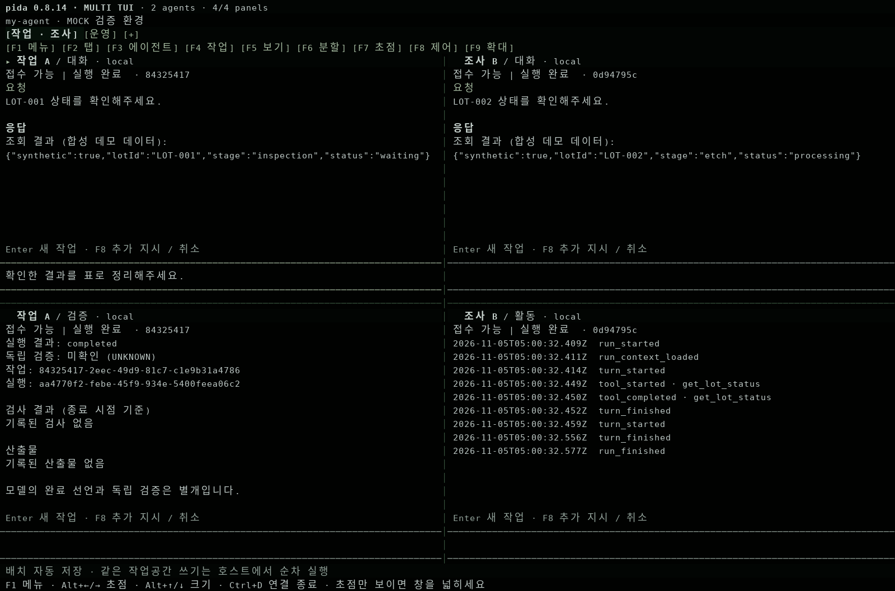

# Pida 0.8.14 — 실제 Web / TUI 멀티 에이전트 작업 환경

2026-11-05. Pi 1.2.0 고정. 이 변경은 Pida 저장소에만 적용했습니다.

## 집에서 실행

기존 서버를 정상 종료한 다음, 이 PR의 작업 브랜치를 갱신합니다.
미커밋 변경으로 `git switch`/`pull`이 거절되면 강제로 초기화하지 마세요.

```powershell
cd D:\pida
git fetch origin
git switch fix/runtime-stabilization-00-02
git pull --ff-only
npm install
npm run build
npm start -- .\my-agent --open
```

서버 창은 그대로 두고 **다른 PowerShell 창**에서 실행합니다.

```powershell
cd D:\pida
npm run tui -- .\my-agent
```

헤더는 `pida 0.8.14 · MULTI TUI`입니다. 이제 기본 `tui`가 멀티 에이전트
화면을 엽니다. 첫 실행에는 빈 패널 하나가 있고, F3에서 에이전트를 생성하거나
연결합니다. 기존 단일 대화/프로젝트 TUI는 `--main`으로 엽니다.
기존 `--session ID`, `--new`도 단일 대화 모드를 명시적으로 선택합니다.
Web에서는 **멀티 에이전트** 탭을 여세요.

## 조작

| 작업 | TUI | Web |
| --- | --- | --- |
| 탭 생성·전환·이름·닫기 | F2 또는 상단 탭 클릭 | + 탭, 탭 클릭, 이름 더블클릭, × |
| 에이전트 생성·연결 | F3 | 패널의 에이전트 선택 / 생성 버튼 |
| 이전 작업·최신 작업 선택 | F4 | 작업 선택 상자 |
| 대화·활동·도구·파일·검증 | F5 | 패널 보기 선택 상자 |
| 좌우·상하 중첩 분할 | F6 | 좌우 / 상하 분할 버튼 |
| 비율 조절 | F6 비율 선택, Alt+↑/↓ 5% 조절 | 경계선 드래그, 경계선 초점 후 방향키 |
| 다른 탭/패널과 자리 교환 | F6 자리 바꾸기 | 자리 바꾸기 선택 상자 |
| 입력 초점 | F7, Alt+←/→, 패널 제목/입력 클릭 | 패널 클릭 / 초점 선택 |
| 확대·분할 복귀 | F9 | 패널 확대 / 분할로 복귀 |
| 새 작업 접수 | Enter, 줄바꿈은 Alt+Enter | 새 작업 접수, Ctrl+Enter |
| 추가 지시·작업 취소·대기열 정지/재개 | F8 | 해당 패널의 버튼 |
| 기억·효과 복구 관리 | F8에서 Web 열기 | 관리 · 기억 · 복구 |
| 연결만 종료 | Ctrl+D | 창 닫기 / 로그아웃 |

최대 8개 탭, 탭마다 4개 패널입니다. 4분할은 대략 160열 × 44행 이상에서
사용하기 편합니다. 비율 때문에 각 패널의 최소 크기를 확보하지 못하면
초점 패널만 표시하며, 창을 넓히면 원래 배치가 돌아옵니다.

패널은 에이전트의 작업을 관찰하는 창입니다. 패널/탭 닫기, 교환, 재접속은
작업을 실행하거나 취소하지 않습니다. 작업 취소는 표시 중인 정확한 job ID에
전달하고, 추가 지시는 그 job의 run ID도 확인합니다. 대기열 정지는 진행 중인
작업을 취소하지 않습니다. 같은 저장소의 쓰기 직렬화·복구 게이트는 유지됩니다.

## 배치와 지시 보존

- TUI: 선택한 workspace의 `stateDir/tui-layouts/<scope>.json`에 원자적으로 저장.
- Web: 호스트+사용자 scope별 브라우저 localStorage에 저장.
- 저장 내용은 탭/패널 ID, 에이전트/작업 참조, 보기, 비율, 초점뿐입니다.
- 미전송 지시, 토큰, 원문 출력은 배치 파일에 저장하지 않습니다. 창을 완전히
  닫으면 미전송 지시는 사라집니다. 탭 이동/분할 중에는 패널별 초안이 유지됩니다.
- Web과 TUI의 **작업 상태는 공유**하지만 화면 배치는 각 클라이언트별입니다.
- 접수 응답이 끊기면 자동으로 재전송하지 않습니다. 접수 여부 확인으로 기록을
  조회하고, 필요할 때 같은 요청 ID로 명시적으로 재전송할 수 있습니다.

Persona 출처는 기존 호스트 카탈로그에서 선택합니다. 새 UI가 외부 Persona
연결을 임의로 만들거나 일반 에이전트의 기억을 외부에 전송하지 않습니다.
PIX/OCEL 관측·검증 인터페이스는 기존 구현을 사용합니다.

## 검증 기록

| 구분 | 결과 |
| --- | --- |
| 계획 | 0.8.12 / 0.8.13 / 0.8.14로 구현 범위 분리 |
| 구현 | 공통 controller/layout, owner별 overview, Web, 실제 Pi TUI 연결 |
| 전체 자동 시험 | `PIDA_TEST_PIX_SOURCE=.pida-test-pix-source npm test` — 372/372 통과, 0 skip; Node 24.22.1/Linux |
| 실제 TUI 렌더러 | 4패널, 한글 입력, 마우스/키보드, 탭 복원, 폭/높이 변경 검증 |
| 실제 터미널 통합 | 아래 PTY 스크립트 18개 확인 통과: 실제 CLI/Pi/HTTP, mock 모델 |
| Web 이벤트 코드 | 실제 fleet 핸들러의 DOM adapter 시험 통과. 브라우저 엔진 시험과 구분 |
| 실제 브라우저 | 미완료: Chromium socket EPERM; 별도 브라우저는 로컬 서버 접근 불가 |
| Windows / 실제 LLM / 회사 게이트웨이 | 미검증. 사용자의 집/회사 환경에서 확인 필요 |
| 외부 공개·릴리스 | 하지 않음. 기존 draft PR에 버전별 커밋만 반영 |

```sh
node scripts/multi-agent-capture.mjs fixtures/workspace/0.8.14
python3 scripts/tui-screen-image.py fixtures/workspace/0.8.14/screens.json
python3 scripts/multi-agent-terminal-check.py --output /tmp/pida-multi-pty.json
```

브라우저 시험은 Chromium이 실행 가능한 환경에서 다음 명령으로 재현합니다.
`PIDA_BROWSER_EXECUTABLE`에 설치된 Chromium/Chrome 실행 파일을 지정할 수 있습니다.

```sh
node scripts/multi-agent-browser-check.mjs /tmp/pida-multi-browser
```

[PTY 기록](../fixtures/workspace/0.8.14/pty-report.json),
[실제 Pi 화면 버퍼](../fixtures/workspace/0.8.14/screens.json).
아래 이미지는 실제 컴포넌트를 실제 HTTP/Pi mock 실행에 연결해 얻은 프레임을
그린 것입니다. HTML 시안, Windows 캡처, 실제 LLM 결과를 뜻하지 않습니다.



## 남은 범위

임의 외부 프로그램의 인터랙티브 터미널을 패널에 내장하거나, worktree를
자동으로 만들거나, 서비스 HTML 미리보기를 터미널에서 렌더링하지 않습니다.
서비스 미리보기는 기존 Web Studio에서 사용합니다. 구조화된 파일/행 대상
선택, Web↔TUI 배치 동기화, 외부 Persona 배포, Schumpeter 변경도 포함하지 않습니다.
이 범위를 지원한다고 표시하지 않았습니다.
