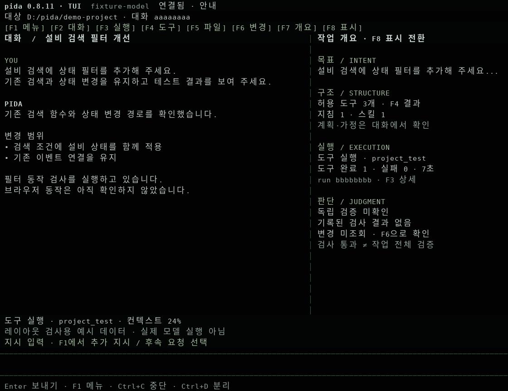

# Pida 0.8.11 — deliver the green theme to the real terminal

2026-11-05 KST. Pida only. Baseline local `9249f3f043b0b63ee8f9e37f9e566abe063acd57`,
remote draft PR #1 `bff069079c1aa47c24227a323cc5a1251a4e4e95`.
Package 0.8.10 → 0.8.11. Pi remains pinned to 1.2.0; no dependency change.

## Report and confirmed cause

The user followed the host + `npm run tui -- .\my-agent` instructions but saw
the simpler terminal instead of the green workbench shown previously.
Repository inspection confirmed a delivery gap: 0.8.10 had the functional
0.8.8 Pi terminal, but `src/tui.ts` still selected ordinary ANSI yellow accents
and did not paint a background. The black-green/cool-type workbench existed as
an HTML design prototype. The shared-surface and multi-agent documents explicitly
listed their newer UI connections as unimplemented. Rebuilding 0.8.10 therefore
could not produce that prototype's theme. The user's exact Windows screen and
checkout were not inspected, so a separate stale-checkout issue is not ruled out.

## Patch and boundaries

1. Reuse the approved colors: background `#010201`, section surface `#020503`,
   text `#bbc6c3`, secondary text `#92a29a`, selection `#051009`.
2. Apply them to actual Pi-rendered frames, including blank cells and composed
   reset sequences. Reuse Pi's protected final-line styling hook; do not fork
   its layout, editor, mouse, scrolling, selection or cursor engine.
3. Keep section and menu headings, the conversation/overview or file view,
   status and request editor visible. Use muted borders and legible secondary
   text instead of applying ANSI dim again. Do not strip trusted section colors
   while continuing to sanitize every untrusted displayed value.
4. Preserve `NO_COLOR`, Pi's 256-color fallback, keyboard and mouse navigation,
   Korean paste, exact-session observation, cancellation and detach behavior.
   No terminal palette/font changes via OSC, no global setting changes.
5. Correct usage/version documentation and state the prototype/implementation
   distinction explicitly. This is an actual terminal theme patch, not the
   implementation of WS-01–07 or MA-01–05.

The current UI still operates main-workspace sessions. Multi-agent tabs and
arbitrary split panes, structured target/line binding and a terminal runtime
manager remain planned. Existing Web and Supervisor capabilities are unchanged.
Font selection belongs to the user's terminal application; a CSS font stack
from the prototype is not installed by this patch.

## Validation

Environment: Linux x64, Node 24.22.1, Pi 1.2.0, Python 3.12.14.

| Layer | Command / actual result |
| --- | --- |
| Build | `npm run build` — PASS |
| Existing TUI integration | `node --test test/tui.test.mjs` — 8 passed, 0 failed/skipped; actual Pi/HTTP, scripted model decisions |
| Real terminal | `python3 scripts/tui-terminal-check.py --color --output .pida-test-tui-0811-reviewed/report.json` — 14 passed; separate mock-model host and CLI in Linux PTY; final report copied into fixtures after verifying source hashes |
| Fallback / opt-out | Real Pi frame smoke with 256-color and monochrome settings — PASS; no truecolor escape in fallback, no Pida color escape in opt-out |
| Actual renderer | `node scripts/tui-view-capture.mjs fixtures/tui/0.8.11` — 6 real Pi frame buffers; explicitly synthetic presentation data |
| Visual review | Wide overview, file panel, menu and narrow frame inspected after rasterizing the recorded ANSI cells; original colors retained |
| Windows Terminal / native Korean IME | NOT_RUN |
| Live model / company gateway / external systems | NOT_RUN; no provider, API or external integration changes |

The first build exposed an anonymous-subclass declaration type error. Explicitly
typing the view as the upstream `TuiAltScreen` corrected it; the final build and
integration results above are after that correction. No full-suite rerun is
claimed for this presentation-only patch. One integrated self-review covered
color/reset composition, untrusted content, existing ownership boundaries,
terminal restoration and the scope represented by the documentation.

[PTY report](../fixtures/tui/0.8.11/pty-report.json) and
[test summary](../fixtures/tui/0.8.11/test-summary.json) include source hashes.
[Frame buffers](../fixtures/tui/0.8.11/screens.json) contain the exact rendered
ANSI/text cells. `python3 scripts/tui-screen-image.py fixtures/tui/0.8.11/screens.json`
optionally rasterizes them with Pillow and Linux fonts for review. The image
below represents **real renderer output with synthetic presentation data**;
it is not a live-model run or a screenshot of the user's Windows machine.

## Use

Update the existing draft PR branch `fix/runtime-stabilization-00-02`, rebuild
that same checkout and attach from a second terminal with
`npm run tui -- .\my-agent`. Keep the existing workspace host running. The
header should show `pida 0.8.11 · TUI`. On a terminal at least 104 columns wide,
the conversation and overview/file panel appear side by side; a narrow window
retains the single-panel layout and F7 opens the overview.

Plan, implementation and Linux component/PTY checks are complete for this theme
correction. User-Windows integration remains unverified. No merge, release,
deployment, other-application modification or new model execution was requested
from the user's workspace.
