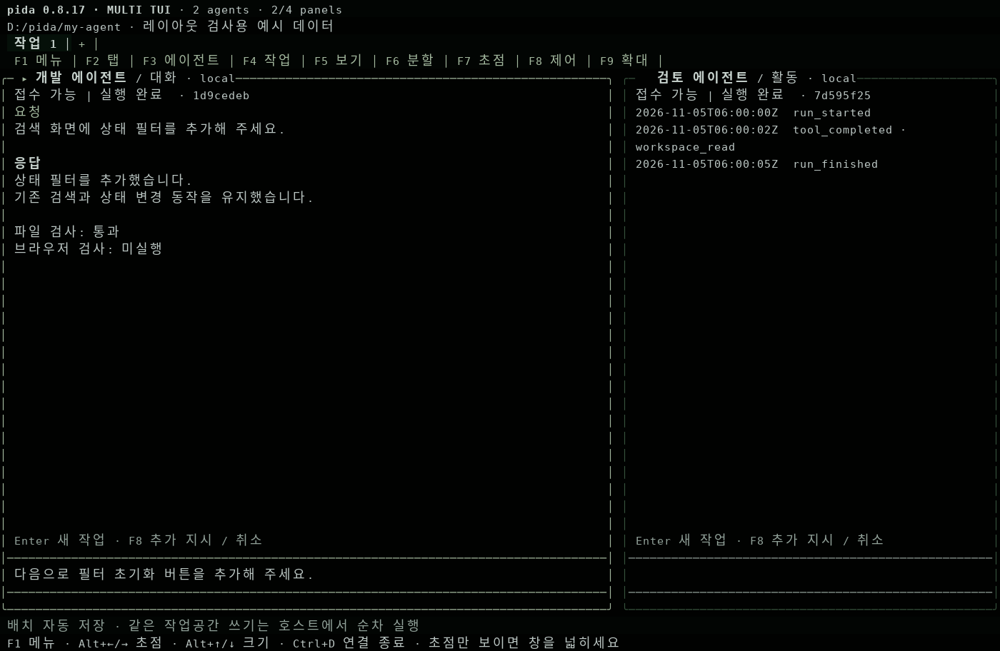
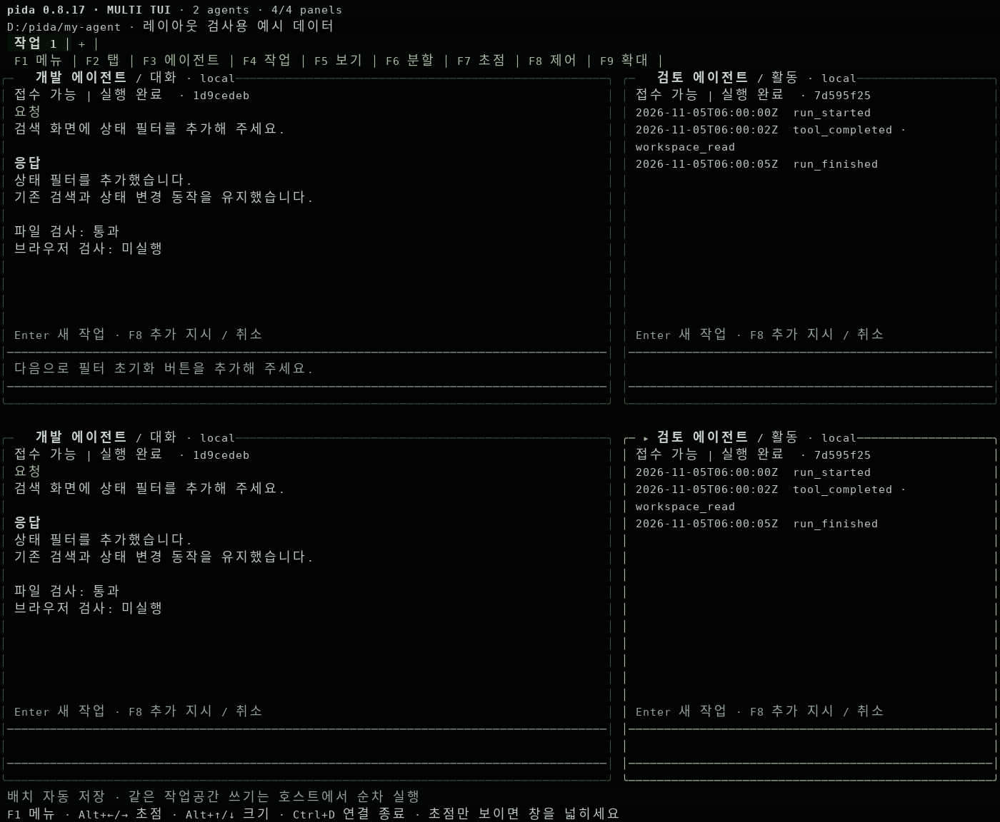

# 첫 화면부터 구획이 보이는 TUI · 0.8.17

0.8.14에는 분할 기능이 있었지만 새 배치가 패널 하나로 시작했고, 메뉴는 대괄호로 표시됐다. 패널 외곽선도 없어 분할 작업대라는 인상을 주지 못했다. 새 버전은 실제 Pi 화면에 각 패널의 상하좌우 경계와 제목을 표시한다.



위 이미지는 **실제 Pi 렌더러 출력에 합성 예시 데이터를 넣어 만든 화면**이다. 디자인 시안, 사용자의 Windows 캡처, 실제 LLM 실행 결과가 아니다.

## 시작과 조작

```powershell
# 업데이트한 소스 폴더에서
npm ci --ignore-scripts
npm run build

# 첫 번째 터미널
npm start -- .\my-agent

# 두 번째 터미널
npm run tui -- .\my-agent
```

서버가 실행 중이면 최신 서버 코드를 적용하기 위해 원래 서버 창에서 정상 종료한 뒤 다시 시작한다. 화면 위 버전은 `pida 0.8.17 · MULTI TUI`다.

- **저장된 배치가 없으면:** 왼쪽 대화, 오른쪽 활동의 두 패널로 시작한다. 각 패널에서 F3으로 에이전트를 연결한다.
- **기존 배치가 있으면:** 패널 수·에이전트 연결·비율을 보존한다. 기존 한 패널 배치를 나누려면 F6 → 좌우 분할을 선택한다.
- **패널 전환:** Alt+←/→, F7 또는 패널 클릭. F5에서 대화·활동·파일·검증 보기를 바꾼다.
- **확대:** F9. 다시 F9를 누르면 분할 배치로 돌아온다.
- **작은 창:** 초점 패널만 표시한다는 안내가 상단에 먼저 나온다. 창을 넓히면 저장된 분할이 돌아온다. 두 패널은 약 110열 × 24행 이상, 네 패널은 160열 × 44행 정도가 편하다.
- **종료:** Ctrl+D는 연결만 닫는다. 실행 취소는 F8에서 선택한다.



## 시험

Pi의 기존 레이아웃·Editor·ScrollView·마우스 처리를 재사용했다. 자체 터미널 에뮬레이터나 별도 입력 엔진을 추가하지 않았다.

- 실제 Pi 렌더러: 두 패널 기본 화면, 네 패널 중첩 분할, 패널별 한글 초안과 전송, 마우스 초점, 작은 창 전환, 원래 편집기 복원.
- Linux PTY의 실제 CLI·HTTP·mock Pi 연결: **18개 점검 통과**. 새 터미널에서 배치 복원, 탭 전환, 정확한 작업 취소, 연결 종료 후 서버 유지, 터미널 입력 모드 복구 포함.
- [프레임 원본](../fixtures/workspace/0.8.17/screens.json), [PTY 기록과 소스 해시](../fixtures/workspace/0.8.17/pty-report.json), [재현 스크립트](../scripts/multi-agent-view-capture.mjs).
- Windows Terminal·PowerShell의 실제 렌더링과 한글 IME, 실모델 동작은 미검증이다. 멀티 탭에서 파일 범위를 요청에 고정하는 UI는 별도 후속 범위다.

전체 사용법은 [한국어 사용 가이드](USER-GUIDE.ko.md)를 따른다.
