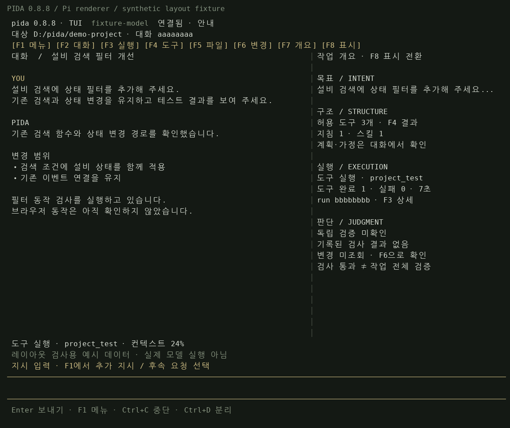

# Pida 0.8.8 — make the terminal work surface visible

2026-11-04 KST. Scope: Pida only. Baseline local commit
`8478be164d3dda641657f0833620a5c091eccc4c`; delivered draft-PR baseline
`ad42558de3c46ce1877682e4f8791ce545c9a321`. Package 0.8.7 → 0.8.8;
Pi remains pinned at 1.2.0. No new dependency or alternate runtime.

## Problem and source of the correction

The user reported that opening the terminal looked like a bare CLI. Code
inspection confirmed that 0.8.7 did use Pi's alternate-screen TUI, but its
default surface was mostly a conversation and input, with detail hidden behind
slash commands. `npm start` also showed server logs without a clear TUI attach
instruction. We have not observed the user's exact Windows command or screen,
so these are two concrete usability gaps, not a claimed reproduction of their
specific launch path.

The user supplied an information-compression/interface-philosophy learning note.
Its saved document text was successfully retrieved after the attachment path
failed. The principles applied here are: retain decision-relevant signals and
relationships; make hidden structure reconstructable; distinguish meaningful
judgment from repetitive interaction; offer explanation levels appropriate to
the user. No historical author intent or cognitive-effect claim is inferred.
The private source document itself is not copied into this repository.

## Patch plan and completed implementation

| Slice | Implementation and reason |
| --- | --- |
| Launch clarity | Server startup explicitly identifies the log window and prints the selected workspace's TUI attach commands. The terminal header shows version and TUI identity. |
| Persistent structure | Wide screens show conversation plus a standing goal/structure/execution/judgment overview. Narrow screens retain goal and verification; F7 opens the full overview. |
| Discoverability | Clickable function-key navigation, F1 action chooser, F5 folder/file picker, and F8 guidance/concise display. Existing slash shortcuts remain. |
| Honest evidence | Read the ended run's actual manifest asynchronously; fence responses by session, run and request. Missing/failed evidence stays unknown. Never turn a completion message or scoped test into independent verification. |
| Change interpretation | F6's actual Git view updates a timestamped whole-worktree count. It is neither automatic polling nor a count of changes caused by one run. |
| Reuse and control | Retain Pi layout/editor/scroll/selection/mouse handling, Pida HTTP ownership/permissions, guarded cancellation and detach semantics. No second agent loop. |
| Validation | Real components, actual Linux PTY host/client integration, synthetic visual captures and the full automated suite. |

Goal is the actual latest user request, not an inferred task description.
The full request remains in conversation. Plan and assumptions remain in model
messages; no separate machine-verified plan or extracted success criteria are
claimed. Available-tool/instruction metadata is displayed only when observed.
Elapsed time uses actual run timestamps, and stops advancing on disconnect.
The UI does not fabricate a progress percentage.

Scoped check summaries are labeled at run end. They are not a check of the
current mutable workspace. The source manifest remains available through F3;
overall verification continues to be UNKNOWN. All file discovery and reads use
the existing server boundary. A permission denial never triggers a fallback to
another file-access path. Opening menus and changing display density sends no
model request. Steering/follow-up choices retain the draft and require Enter to
submit it; ordinary authorized work gains no new approval loop.

## Validation gates

| Gate | Actual result |
| --- | --- |
| Plan / implementation | Complete for the 0.8.8 terminal usability slice |
| `npm test` | PASS — 356 tests, 0 failures/cancelled/skipped; build included; 24.794298 s |
| `python scripts/tui-terminal-check.py --output .pida-test-tui-088-final/report.json` | PASS — 12 actual Linux PTY checks, separate Pida host and actual Pi renderer/editor; mock model decisions |
| `node scripts/tui-view-capture.mjs .pida-test-tui-088-final/screens` | Five real Pi screen-buffer layouts captured with explicitly synthetic presentation data |
| Visual inspection | Wide running/result, menu, narrow conversation and narrow overview inspected; long-goal resize no longer hides verification |
| Integration | Existing actual Pi/HTTP shared-run, detach/reattach, cancellation and owner-boundary tests pass; new evidence identity and file-picker behavior pass |
| Actual browser / live LLM / company API | NOT_RUN |
| Native Windows Terminal / Korean IME | NOT_RUN; Linux Korean paste is not a Windows IME result |

Environment: Linux x64, Node 24.22.1, npm 11.9.0, Python 3.12.14, Pi 1.2.0.
The full suite includes eight TUI scenarios, genuine renderer SGR mouse input,
keyboard menu/file selection, path-with-space reading, draft preservation,
denied-access handling, delayed old-session evidence and narrow-layout signals.

One integrated self-review was performed. It corrected resize-time clipping of
fixed-height signals, compact overview visibility, stale evidence responses and
elapsed-time presentation after disconnect. No independent review is claimed.
Final source hashes and test counts are retained with the evidence below.

## Evidence and example screen

- [PTY report with source hashes](../fixtures/tui/0.8.8/pty-report.json)
- [Suite summary and transcript digest](../fixtures/tui/0.8.8/test-summary.json)
- [Five actual Pi renderer buffers](../fixtures/tui/0.8.8/screens.json)

The image below rasterizes the real Pi renderer's cells using synthetic layout
data and illustrative terminal colors/fonts. It is not a live model run or a
capture of the user's Windows machine. The JSON records exact terminal rows.

## Use and limits

See [startup and controls](TUI.md). Start one host with
`npm start -- .\my-agent --open`, then use a second terminal for
`npm run tui -- .\my-agent`. The header should display `pida 0.8.8 · TUI`.

This remains the main-workspace client. Persistent-agent administration,
provider login and service preview remain in Web. The existing host must stay
running; no autodaemon, native PTY executor, independent acceptance engine,
other-application modification, merge, release or deployment is included.
