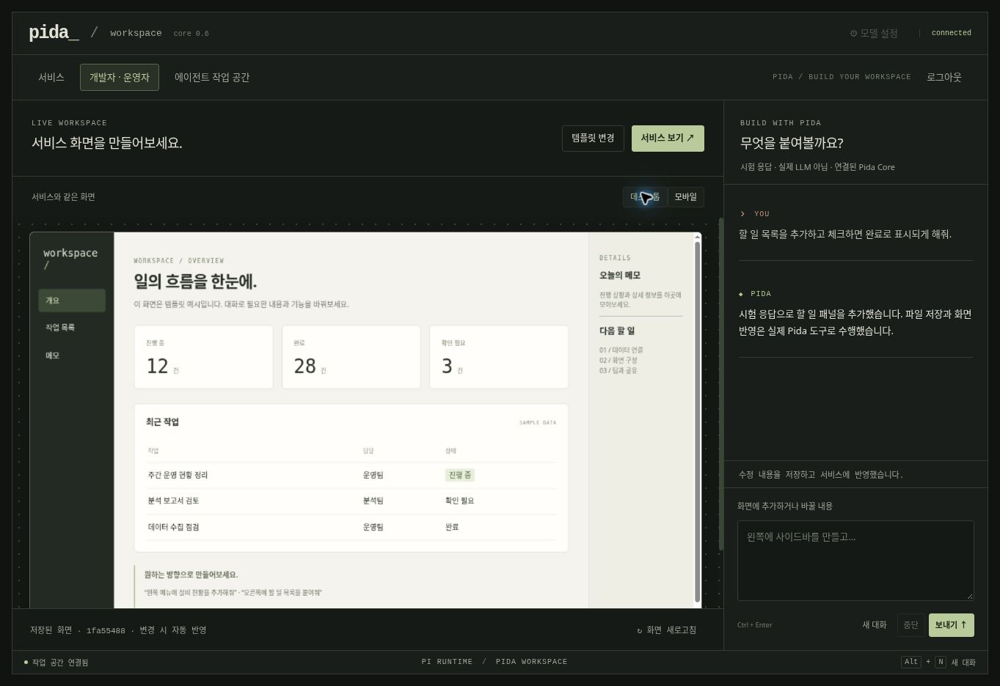

# UI Studio (0.6)

For the 2026-10-28 product/design direction and Web-versus-existing-TUI evaluation, see [INTERFACE-DIRECTION.md](INTERFACE-DIRECTION.md). That document is a proposal, not a claim of newly implemented UI or general repository execution. The behavior below describes the existing studio.

The bundled local workspace now has three views:

- **서비스**: the saved service app at the available browser size.
- **개발자 · 운영자**: a scaled desktop/mobile preview of that same document beside a dedicated Pida conversation.
- **에이전트 작업 공간**: the existing general chat, files, run trace and skills.

Choose **템플릿 선택** to start with sidebar, three-column, top-navigation or blank layouts. Template menus and the example task filter work immediately. Template data is explicitly illustrative. Replacing a template replaces the current app, with its previous file contents retained in workbench Git checkpoints.

Connect a real model through the existing model settings. In the operator chat, try:

> 왼쪽 메뉴에 설비 현황을 추가하고, 상태별로 필터링할 수 있게 해줘. 기존 기능은 유지해줘.

Pida receives instructions and registered `ui_read` / `ui_patch` / `ui_apply` tools through the existing Pi loop. It reads the current document and revision before applying small exact edits or a full HTML document. The interface refreshes after tool completion and when the run finishes. No external coding agent builds the user's app on behalf of Pida. The stock mock cannot perform free-form editing; the UI keeps its editing composer disabled and explains how to connect a model.

## Persistence and concurrency

The document is `app/index.html` in the authenticated principal's workbench. Both service and studio load that file; there is no separate mockup. The page source persists across server restarts. One app per principal is supported in this release. The studio conversation is a normal persisted Pi session; the browser remembers only its session ID, never credentials.

`ui_apply` requires `expectedRevision` from `ui_read`. A stale edit returns `UI_REVISION_CONFLICT`; the model must reread and merge. Template selection uses the same check. Direct workbench file edits and Git restores remain possible and are reflected on the next refresh. Updates are immediate for the current browser's editing flow; there is no multi-client push service or publish/approval stage. If a later tool fails or a run is cancelled, already saved edits remain saved.

Tools: `ui_templates`, `ui_read`, `ui_patch`, `ui_apply`. Existing workbench read/write permissions apply on the server. The HTTP endpoints are authenticated `GET /v1/studio` and `POST /v1/studio/template` (`templateId`, `expectedRevision`). Existing workbench file and Git APIs remain available.

## Interactive app boundary

The app may use self-contained HTML, inline CSS, inline SVG, and inline JavaScript with `addEventListener`. Event-handler attributes such as `onclick` are removed. No npm builds, React development server, external scripts/styles, imports, network access, frames, form submission, popups, parent DOM access or browser-storage persistence are provided.

The public `/studio-frame.html` is only a renderer shell and contains no user document or authentication token. The authenticated parent passes the saved HTML to its own iframe window. The response is sandboxed with `allow-scripts` only, a per-response script nonce, `connect-src 'none'`, `frame-src 'none'`, and `frame-ancestors 'self'`. The parent checks the source window of messages; the child accepts content only from its parent. Pida's host page keeps its existing CSP. Static artifact previews keep their original no-script sandbox.

Service and preview have independent in-memory interaction state. A checkbox click or typed memo in one frame does not update the other, and it does not persist after reload. Persisted business records, authenticated API actions and database connectors need an explicit host integration. Rendering a page is not evidence of correct business logic; a generated script can still fail or consume excessive browser resources. This is not an independently audited code sandbox.

The developer/operator label is a navigation distinction, **not a new role boundary**. Local workspace users with existing workbench write permissions can edit the app. Separate operator roles, SSO, shared organizational services, release approvals and production administration remain future work.

## Validation

- Tests execute the real Pi loop with scripted provider responses to read a template, add a section, and preserve it during a follow-up edit.
- Tests cover persistent restoration, per-principal separation, missing write permission, revision conflict, malformed/oversized writes, Git restoration, authenticated HTTP access and renderer policy.
- Cloud Chromium inspection confirmed template selection, live tool-driven update, identical saved app in the service view, working menu/search and checkbox interactions. Provider responses in this acceptance test were scripted and explicitly labelled; this does not validate a real model's design or reasoning quality.

Real enterprise endpoints, arbitrary model-generated apps, mobile device/browser combinations, and production multi-user operation are not certified by these checks.
