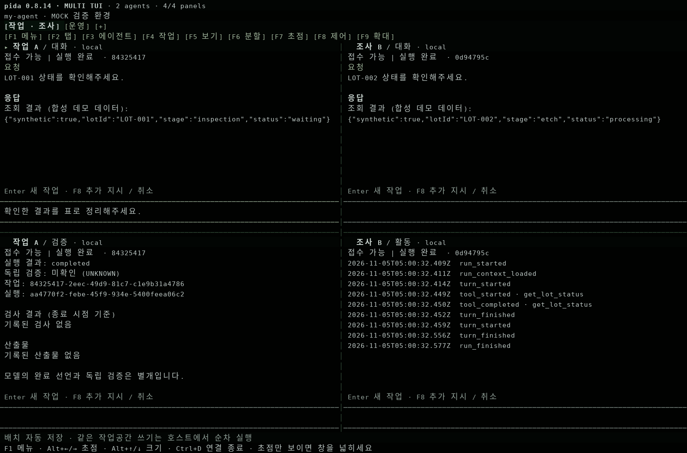

# Pida 사용 가이드

설치부터 첫 대화, 멀티 에이전트 화면, 재실행과 오류 복구까지 안내합니다.

**문서 기준:** Pida **0.8.14** · 2026년 11월 5일  
**대상:** 자신의 컴퓨터에서 Pida를 실행하는 사용자  
**명령 예시:** Windows PowerShell. macOS·Linux에서는 `.\my-agent`를 `./my-agent`로 바꿉니다.

> **먼저 기억할 한 가지**  
> Pida는 **서버 하나에 Web과 TUI를 연결**해서 사용합니다. 서버를 켜는 창과 TUI를 여는 창은 서로 다릅니다. TUI나 브라우저를 닫아도 서버와 실행 중인 작업은 유지됩니다.

## 필요한 곳부터 읽기

| 하려는 일 | 안내 |
| --- | --- |
| 처음 설치하고 모델 연결하기 | [1. 준비와 설치](#1-준비와-설치) · [2. 모델 연결과 첫 대화](#2-모델-연결과-첫-대화) |
| 오늘 다시 켜기 | [3. 평소 시작하고 종료하기](#3-평소-시작하고-종료하기) |
| 여러 에이전트를 나누어 보기 | [4. 멀티 에이전트 TUI](#4-멀티-에이전트-tui) · [5. Web 화면](#5-web-화면) |
| 기존 방식의 단일 대화 열기 | [6. 단일 대화 TUI](#6-단일-대화-tui) |
| 저장소 코딩 작업 맡기기 | [7. 기존 프로젝트 연결](#7-기존-프로젝트-연결) |
| 최신 코드로 업데이트하기 | [8. 업데이트와 데이터 보관](#8-업데이트와-데이터-보관) |
| 잠금 때문에 다시 켜지지 않기 | [9. 잠금과 재시작 문제](#9-잠금과-재시작-문제) |
| 작업 상태나 검증 결과 이해하기 | [10. 작업 상태와 실행 근거](#10-작업-상태와-실행-근거) |
| 명령만 빠르게 찾기 | [11. 자주 쓰는 명령](#11-자주-쓰는-명령) |

## 1. 준비와 설치

### 준비물

| 준비물 | 용도 |
| --- | --- |
| Git | 소스 다운로드·업데이트, 작업 파일의 변경 기록 |
| Node.js **22.19 이상**과 npm | Pida 설치·빌드·실행 |
| 대화형 터미널 | TUI 입력과 화면 표시 |
| 웹 브라우저 | 모델 설정과 Web 작업 화면 |
| 모델 연결 | 실제 작업에 필요. 데모만 확인할 때는 생략 가능 |

이 가이드는 **npm**을 기준으로 설명합니다. Pida 0.8.14의 pnpm 잠금파일에는 TUI 의존성 반영 누락이 확인되어, `pnpm install --frozen-lockfile`이 실패할 수 있습니다. 런타임의 `Workspace is locked` 오류와는 다른 문제입니다.

### 처음 설치할 때

터미널에서 저장소를 둘 폴더로 이동한 뒤 실행합니다.

```powershell
git clone --branch fix/runtime-stabilization-00-02 https://github.com/riesling-29/pida.git
cd pida
npm ci --ignore-scripts
npm run pida -- setup .\my-agent
```

마지막 명령은 빌드 후 `my-agent` 작업공간을 만들고, 서버를 시작하고, 브라우저의 모델 설정을 엽니다. **이 터미널은 서버 창이므로 그대로 둡니다.**

> 0.8.14 코드는 `fix/runtime-stabilization-00-02` 브랜치에 있습니다. `main`에는 아직 병합되지 않았습니다. 이미 저장소가 있다면 다시 복제하지 말고 [업데이트 절차](#8-업데이트와-데이터-보관)를 따릅니다.

### 두 폴더의 차이

| 폴더 | 들어 있는 것 | 이 가이드의 예 |
| --- | --- | --- |
| 소스 폴더 | Pida 코드, `package.json`, 빌드 결과 | `pida` |
| 작업공간 폴더 | 모델 설정, 인증 정보, 대화, 에이전트 상태 | `pida/my-agent` |

이후 명령은 특별한 안내가 없으면 **소스 폴더 `pida`에서 실행**합니다. `my-agent`는 예시 이름이며, 다른 이름을 사용했다면 모든 명령에 같은 경로를 넣습니다. 경로에 공백이 있으면 따옴표로 감쌉니다.

## 2. 모델 연결과 첫 대화

### 사용할 모델 선택

Web의 **모델 설정**에서 연결 방식을 선택합니다.

| 연결 방식 | 설정할 내용 |
| --- | --- |
| 클라우드 API | 제공자, API 키, 모델을 선택 |
| LM Studio | LM Studio에서 모델과 로컬 서버를 준비한 뒤 주소·모델 선택. Pida 기본값은 `http://localhost:1234/v1` |
| Ollama | 실행 중인 서버 주소와 설치된 모델 선택 |
| 사내 API · LightLLM / LiteLLM | 관리자가 제공한 주소·모델 ID·인증 및 프로토콜 설정 사용 |
| 데모만 사용 | 모델 계정 없이 예시 조회를 시험 |

모델을 선택한 뒤 **연결 확인 후 적용**을 누릅니다. 짧은 응답 시험이 성공하면 설정이 저장됩니다. 이 시험은 실제 모델 호출이므로 제공자에 따라 비용이나 사용량이 발생할 수 있습니다. 도구 실행까지 보장하는 시험은 아닙니다.

LM Studio나 다른 서버의 모델 목록이 나오지 않으면 서버 실행 여부와 주소를 먼저 확인합니다. 목록 API가 없는 서버에서는 정확한 모델 ID를 직접 입력합니다. 고급 설정의 컨텍스트 크기와 출력 한도는 실제 서버에서 사용하는 값에 맞춥니다.

### ChatGPT 계정 연결을 사용하는 경우

Pida에는 **OpenAI → 인증 방식 → ChatGPT 계정 · 구독 사용** 경로가 구현되어 있습니다. **Continue with ChatGPT**로 로그인한 뒤, 사용 가능한 모델을 선택하고 **연결 확인 후 적용**을 눌러야 모델 설정까지 적용됩니다.

실제 계정의 이용 가능 여부와 로그인·추론은 별도 확인이 필요합니다. 이 버전의 시험 기록은 실제 계정 검증을 완료했다고 주장하지 않습니다. 자세한 절차는 [ChatGPT 연결 안내](CHATGPT-AUTH.md)를 참고합니다.

### 첫 대화 확인

- **데모 모드:** Web의 대화 입력창에 `LOT-001의 상태를 알려줘`를 입력합니다. 합성 예시 데이터가 나오는 것이 정상입니다.
- **실제 모델:** 간단한 대화가 되는지 확인한 다음, 작은 파일 작업을 요청해 도구 사용까지 확인합니다.

데모 모드는 정해진 예시를 보여주는 기능입니다. 임의의 코딩·문서 작성 요청을 처리하는 언어모델은 아닙니다.

모델을 다시 바꾸려면 Web의 **모델 설정**을 사용합니다. 실행 중인 작업이 있으면 먼저 마무리하거나 명시적으로 취소합니다. 기본 화면에서는 모델 설정을 작업공간 전체가 공유하며, 패널마다 별도 모델을 고르는 기능은 제공하지 않습니다.

## 3. 평소 시작하고 종료하기

### 서버가 꺼져 있을 때

**첫 번째 터미널 — Pida 소스 폴더에서 서버 실행**

```powershell
npm start -- .\my-agent --open
```

`Pida ready:`와 작업공간 경로가 표시되면 서버가 열린 것입니다. `--open`은 브라우저도 엽니다. 터미널에 로그만 보이는 것은 정상입니다.

**두 번째 터미널 — TUI 연결**

같은 소스 폴더에서 실행합니다.

```powershell
npm run tui -- .\my-agent
```

화면 위에 **`pida 0.8.14 · MULTI TUI`**가 표시되는지 확인합니다. Web만 사용할 때는 두 번째 터미널이 필요 없습니다.

### 서버가 이미 켜져 있을 때

TUI는 위의 `npm run tui` 명령으로 다시 연결합니다. Web만 다시 열려면 다음 명령을 사용합니다.

```powershell
node dist/cli.js open .\my-agent
```

같은 작업공간에 `npm start`를 한 번 더 실행하면 중복 서버를 막는 잠금 오류가 날 수 있습니다.

### 무엇을 닫는지 구분하기

| 동작 | 결과 |
| --- | --- |
| TUI에서 **Ctrl+D** | TUI 연결 종료. 서버와 작업은 유지 |
| 브라우저 닫기·로그아웃 | Web 연결 종료. 서버와 작업은 유지 |
| 탭·패널 닫기 | 해당 화면만 닫힘. 에이전트 삭제나 작업 취소가 아님 |
| **이 작업 취소** | 선택한 작업에 취소 요청. 이미 변경된 파일은 자동 복원되지 않음 |
| **대기열 정지** | 이후 작업의 실행을 보류. 현재 실행 중인 작업은 계속됨 |
| **서버 창에서 Ctrl+C** | Pida 서버 종료. 진행 중 작업은 중단될 수 있음 |

완전히 종료할 때는 진행 중인 작업을 확인하고, **서버 창에서 Ctrl+C를 누른 뒤 명령 프롬프트로 돌아올 때까지 기다립니다.** 다시 켜도 저장된 대화와 에이전트 기록은 남습니다. 중단된 작업은 자동으로 재실행하지 않습니다.

## 4. 멀티 에이전트 TUI



*실제 Pi TUI 렌더러에서 얻은 화면 버퍼를 이미지로 만든 예시입니다. 합성 데이터·mock 모델을 사용했으며, Windows 화면 캡처나 실제 LLM 실행 결과는 아닙니다.*

### 에이전트 두 개로 시작하기

1. **F3 → 새 에이전트**에서 이름을 입력합니다.
2. Persona 출처에서 로컬 항목을 선택합니다. 외부 연결은 호스트에 등록된 경우에만 나타납니다.
3. 패널 아래 입력창에 작업을 입력하고 **Enter**로 보냅니다.
4. **F6**에서 좌우 또는 상하 분할을 선택합니다.
5. 새 패널에서 **F3**으로 다른 에이전트를 만들거나 기존 에이전트를 연결합니다.

데모 모드에서는 첫 에이전트에 `LOT-001`, 두 번째 에이전트에 `LOT-002` 조회를 요청하면 입력 대상이 나뉘는지 확인하기 쉽습니다.

**탭은 화면 묶음, 패널은 에이전트의 작업을 보는 창**입니다. 새 탭이나 새 패널을 만드는 것만으로 에이전트가 생성되지는 않습니다. 같은 에이전트를 여러 패널에 연결해 한쪽은 대화, 다른 쪽은 활동이나 검증으로 볼 수도 있습니다.

### 주요 조작

| 하려는 일 | 키 또는 메뉴 |
| --- | --- |
| 전체 메뉴 | **F1** |
| 탭 생성·전환·이름 변경·닫기 | **F2** 또는 상단 탭 클릭 |
| 에이전트 생성·연결 | **F3** |
| 과거 작업 선택·최신 작업 따라가기 | **F4** |
| 대화·활동·도구·파일·검증 보기 | **F5** |
| 좌우·상하 분할, 패널 닫기·교환 | **F6** |
| 분할 비율 조절 | **F6**의 비율 메뉴 또는 **Alt+↑/↓** |
| 입력할 패널 선택 | **F7**, **Alt+←/→**, 패널 클릭 |
| 추가 지시·취소·대기열 정지/재개 | **F8** |
| 선택 패널 확대·분할 화면 복귀 | **F9** |
| 새 작업 보내기 | **Enter** |
| 입력창 줄바꿈 | **Alt+Enter** |
| 메뉴 닫기 | **Esc** |
| TUI 연결만 종료 | **Ctrl+D** |

멀티 에이전트 모드에서 **Ctrl+C는 실행 제어 메뉴를 엽니다.** 서버 종료는 서버 창에서, 작업 취소는 F8에서 선택합니다. 노트북의 기능키가 음량·밝기로 동작하면 Fn 키와 함께 누르거나 상단 메뉴를 클릭합니다.

### 분할과 저장 범위

- 최대 **8개 탭**, 탭마다 **4개 패널**을 만들 수 있습니다.
- 네 패널을 함께 보려면 대략 **160열 × 44행 이상**이 편합니다. 창이 작으면 선택한 패널만 보이고, 넓히면 분할 배치가 돌아옵니다.
- 탭 이동·분할 중에는 패널별 입력 초안이 유지됩니다. **창을 완전히 닫으면 보내지 않은 초안은 사라집니다.**
- 탭·패널 연결과 비율은 저장됩니다. Web과 TUI는 작업 상태를 공유하지만 **화면 배치는 각각 저장**합니다.
- 패널 수가 동시 실행 수를 뜻하지는 않습니다. 같은 프로젝트를 수정하는 작업은 기존 실행 제한에 따라 순서대로 처리됩니다.

전송 직후 연결이 끊겨 접수 여부가 불명확하면 **F8 → 미확인 요청 접수 여부 확인**을 먼저 사용합니다. 필요한 경우 같은 요청 ID로 재전송할 수 있습니다.

## 5. Web 화면

Web 상단에서 목적에 맞는 화면을 고릅니다.

| 화면 | 주로 사용하는 일 |
| --- | --- |
| **멀티 에이전트** | 여러 에이전트의 대화·활동·도구·파일·검증을 탭과 패널로 관찰 |
| **상주 에이전트** | 에이전트 역할·기억·대기열·중단 작업 복구 관리 |
| **개발자 · 운영자** | 파일·변경 내역·정적 서비스 미리보기를 보며 작업 |
| **에이전트 작업 공간** | 기존 대화·실행 정보를 중심으로 작업 |
| **서비스** | 작업공간에 만든 서비스 HTML 화면 보기 |

### 멀티 에이전트 화면의 기본 순서

1. **에이전트 생성**으로 이름과 선택적 역할을 입력하고 Persona 출처를 고릅니다.
2. 각 패널에서 에이전트·작업·보기를 선택합니다.
3. **좌우 분할 / 상하 분할**로 나누고, 경계선을 드래그해 크기를 조절합니다.
4. 입력창 아래 **새 작업 접수** 또는 **Ctrl+Enter**로 보냅니다.
5. 실행 중인 작업에 지시를 더하려면 **실행 중 추가 지시**를 사용합니다.

**관리 · 기억 · 복구**는 상주 에이전트 화면으로 이동합니다. 탭 이름은 더블클릭해 바꾸고, 패널은 확대하거나 다른 패널과 자리를 바꿀 수 있습니다.

새 작업과 추가 지시는 구분됩니다. 새 작업은 대기열에 접수하고, 추가 지시는 현재 실행 중인 해당 작업에 전달합니다. 과거 작업을 선택하는 것은 조회이며 재실행이 아닙니다.

### 서비스 미리보기의 범위

서비스 화면은 작업공간의 정적 HTML 미리보기입니다. 기존 저장소의 React 개발 서버나 임의의 외부 터미널을 자동으로 패널 안에 실행하는 기능은 아닙니다. 실제 프로젝트 파일은 [프로젝트 연결](#7-기존-프로젝트-연결)로 다룹니다.

## 6. 단일 대화 TUI

기존 대화 중심 화면을 사용하려면 `--main`을 붙입니다.

```powershell
npm run tui -- .\my-agent --main
```

새 대화는 `--new`, 특정 메인 세션은 `--session`으로 엽니다. `<세션-ID>`는 실제 UUID로 바꿉니다.

```powershell
npm run tui -- .\my-agent --new
npm run tui -- .\my-agent --session <세션-ID>
```

이 옵션들은 **메인 단일 대화 모드**를 선택합니다. 멀티 에이전트의 개별 작업을 고르려면 F4를 사용합니다.

| 단일 대화에서 할 일 | 명령 |
| --- | --- |
| 메뉴·도움말 | `/menu`, `/help` |
| 대화 목록·새 대화 | `/sessions`, `/new` |
| 실행 기록·도구 결과 | `/activity`, `/tools` |
| 파일·변경 내역 | `/files`, `/read 경로`, `/diff` |
| 현재 실행에 추가 지시 | `/steer 추가할 내용` |
| 현재 작업 이후에 입력 예약 | `/followup 다음 요청` |
| 대화 압축·요약 후 새 대화로 이어가기 | `/compact`, `/handoff` |
| 현재 실행 취소 | `/stop` |
| 같은 대화를 Web에서 열기 | `/web` |
| OCEL 확인 | `/ocel` |
| 연결 종료 | `/quit` 또는 **Ctrl+D** |

`/followup` 대기 입력은 서버 재시작까지 보존되는 에이전트 작업 대기열과 다릅니다. 단일 대화 모드의 기능키는 멀티 에이전트 모드와 다르므로 위 명령이나 [단일 대화 단축키 표](TUI.md#single-session-commands-and-controls---main)를 참고합니다.

## 7. 기존 프로젝트 연결

Pida 작업공간과 실제로 수정할 프로젝트 저장소는 따로 지정합니다. 먼저 **서버를 종료**한 다음, Pida 소스 폴더에서 실행합니다. 아래 프로젝트 경로는 실제 경로로 바꿉니다.

```powershell
node dist/cli.js project enable "C:\work\sample-project" .\my-agent
npm start -- .\my-agent --open
```

이 명령은 지정한 프로젝트의 **파일 읽기·쓰기**를 허용합니다. 테스트·빌드 등 호스트 명령 실행까지 허용하려면, 서버를 종료한 상태에서 `--trusted-host`를 붙여 설정합니다.

```powershell
node dist/cli.js project enable "C:\work\sample-project" .\my-agent --trusted-host
npm start -- .\my-agent --open
```

> `--trusted-host`는 실제 컴퓨터 권한으로 명령을 실행하도록 허용합니다. 프로젝트 경로가 운영체제의 접근 제한 경계가 되는 것은 아닙니다. 사용할 실행 환경과 의존성은 호스트에 준비되어 있어야 합니다.

실제 모델을 연결한 뒤 작은 작업부터 확인합니다.

> 프로젝트의 AGENTS.md와 테스트 구성을 읽고, 지정한 실패 테스트 하나를 재현해 주세요. 필요한 최소 수정 후 같은 테스트를 다시 실행하고, 변경 파일과 실행 명령·결과를 알려주세요.

결과는 변경 내역과 실제 테스트 출력으로 확인합니다. 파일 검색 도구 중 `project_grep`은 PATH에 설치된 `rg`가 필요합니다. 프로젝트 저장소 변경은 서비스 작업공간의 복원 기능으로 되돌아간다고 가정하지 않습니다.

연결을 해제할 때도 서버 종료 후 실행하고 다시 시작합니다.

```powershell
node dist/cli.js project disable .\my-agent
```

세부 권한과 제한은 [프로젝트 코딩](PROJECT-CODING.md), 긴 실행 명령은 [명령 관리](COMMANDS.md)를 참고합니다.

## 8. 업데이트와 데이터 보관

서버를 정상 종료하고 작업공간을 백업한 뒤, 기존 Pida 소스 폴더에서 실행합니다.

```powershell
git status --short
git fetch origin
git switch fix/runtime-stabilization-00-02
git pull --ff-only origin fix/runtime-stabilization-00-02
npm ci --ignore-scripts
npm run build
node -p "require('./package.json').version"
npm start -- .\my-agent --open
```

**각 단계가 성공한 뒤 다음으로 진행합니다.** Git이 로컬 변경이나 브랜치 충돌을 알리면 중단하고 변경 내용을 먼저 보관·검토합니다. 이 절차에는 강제 초기화나 기존 작업공간 재생성이 필요하지 않습니다.

새 터미널에서 `npm run tui -- .\my-agent`로 연결합니다. 소스만 갱신하고 빌드하지 않으면 이전 실행 파일이 열릴 수 있습니다.

| 보관할 대상 | 내용 |
| --- | --- |
| `my-agent/pida.config.json` | 모델·도구·권한·프로젝트 설정 |
| `my-agent/.env` | 애플리케이션 토큰과 환경 설정 |
| 설정의 `stateDir` 폴더, 기본값 `.pida` | 대화·에이전트·작업·기억·일부 인증 상태와 작업 파일 |
| 별도로 연결한 프로젝트 폴더 | 실제 소스와 산출물 |

작업공간은 서버가 꺼진 상태에서 **폴더 전체를 백업**하는 편이 간단합니다. 백업에는 인증 정보와 대화 내용이 들어갈 수 있으므로 공개 저장소에 올리지 않습니다. 별도의 프로젝트 폴더도 필요에 따라 따로 보관합니다.

## 9. 잠금과 재시작 문제

### `Workspace is locked`가 나올 때

Pida는 같은 작업공간을 두 서버가 동시에 쓰지 못하도록 `runtime.lock`을 만듭니다. 정상 종료 때 해제하지만, 강제 종료 뒤 파일이 남을 수 있습니다. 0.8.14의 런타임은 남은 잠금을 시작 시 자동으로 제거하지 않습니다.

**1. 서버 창이 남아 있는지 확인합니다.**

서버가 실행 중이면 새 서버를 띄우지 않고 TUI나 Web만 연결합니다. TUI를 닫은 것이 서버 종료는 아닙니다.

**2. 기존 서버가 종료됐는데 오류가 계속되면 명시적으로 복구합니다.**

```powershell
node dist/cli.js unlock .\my-agent
```

`No stale lock remains.`가 표시되면 다시 실행합니다.

```powershell
npm start -- .\my-agent --open
```

`unlock`은 같은 컴퓨터에서 종료가 확인된 프로세스의 루트·에이전트 런타임 잠금을 해제합니다. 세션과 산출물은 지우지 않습니다. 다른 컴퓨터의 잠금이나 소유자를 확인할 수 없는 잠금, 메모리 쓰기 잠금까지 일괄 삭제하지 않습니다.

| 표시되는 메시지 | 의미와 다음 확인 |
| --- | --- |
| `Workspace process is still running` | 기록된 프로세스가 존재한다고 판정됨. 기존 Pida 서버를 확인하고 정상 종료 |
| `Cannot verify lock owner` | 소유자·호스트·프로세스 확인 실패. 잠금과 상태를 보존하고 진단 필요 |
| `AGENT_SUPERVISOR_LOCKED` | 에이전트 관리 프로세스의 잠금 문제. 기존 서버와 오류 원문 확인 |
| `MEMORY_BUSY` | 메모리 쓰기 잠금. 강제 종료 후 지속되면 백업 후 별도 복구가 필요하며 `unlock` 대상이 아님 |
| `AGENT_RECOVERY_REQUIRED` / `EFFECT_STATE_UNKNOWN` | 이전 작업의 변경 결과가 미확인. 아래 실행 복구 절차 사용 |

같은 메시지가 반복되면 다음 정보로 원인을 좁힐 수 있습니다. 설정 파일·토큰·전체 대화 대신 **실행 명령, 오류 원문, 버전, 서버 창 존재 여부**를 확인합니다.

```powershell
git branch --show-current
node -p "require('./package.json').version"
node dist/cli.js doctor .\my-agent
```

`doctor`는 설정·자격증명 존재 여부·경로 등을 검사하는 정적 진단입니다. 잠금 자동 해제나 실제 모델 접속 시험은 하지 않습니다.

### 서버는 켜지지만 작업이 재개되지 않을 때

비정상 종료 도중 파일 수정이나 명령 실행이 있었다면, Pida는 그 결과를 확인하기 전까지 후속 작업을 보류할 수 있습니다.

1. Web의 **상주 에이전트** 또는 **관리 · 기억 · 복구**를 엽니다.
2. **미확인 변경 확인**에서 해당 작업과 실제 파일·외부 상태를 확인합니다.
3. 확인된 변경을 적용됨/미적용으로 기록하고 확인 절차를 마칩니다.
4. 대기열을 별도로 **재개**합니다.

이 절차는 중단된 작업을 성공으로 바꾸거나 그대로 다시 실행하지 않습니다. 메인 단일 대화의 미확인 효과는 `recovery` 명령으로 조회할 수 있습니다. 세부 절차는 [상주 에이전트 복구 안내](PERSISTENT-AGENTS.md)를 참고합니다.

### 그 밖의 자주 겪는 문제

| 증상 | 확인할 것 |
| --- | --- |
| TUI 대신 로그만 보임 | `npm start`는 서버 창. 다른 터미널에서 `npm run tui -- .\my-agent` 실행 |
| TUI가 서버에 연결하지 못함 | 서버 실행 여부, 두 명령의 작업공간 경로, `doctor` 결과 확인 |
| 예전 화면·버전이 열림 | 현재 브랜치와 `package.json` 버전 확인, `npm run build`, 서버·TUI 재실행 |
| 분할했는데 패널 하나만 보임 | F9 확대 여부 확인, 터미널 창 확장 |
| 녹색 테마가 보이지 않음 | 터미널 색상 지원과 `NO_COLOR` 설정 확인. 글꼴은 터미널 앱에서 설정 |
| Web 새로고침 후 로그인 필요 | 정상 동작. `node dist/cli.js open .\my-agent`로 다시 열기 |
| 연결 확인은 성공했지만 작업 실패 | 도구 호출 지원, 실제 모델 한도, 권한 및 실행 결과 확인 |

브라우저 자동 열기가 동작하지 않으면 서버가 표시한 주소로 직접 접속합니다. 기본값은 `http://127.0.0.1:8787`입니다. 로그인에 필요한 **Pida 애플리케이션 토큰**은 `node dist/cli.js token .\my-agent`로 확인할 수 있습니다. 이 명령은 비밀값을 화면에 출력하므로 공유 로그에 포함하지 않습니다. 모델 API 키를 대신 넣는 곳이 아닙니다.

## 10. 작업 상태와 실행 근거

| 상태 | 읽는 방법 |
| --- | --- |
| 대기 `queued` | 작업은 접수됐고 실행 순서를 기다리는 중 |
| 실행 중 `running` | 모델 또는 도구 실행이 진행 중 |
| 실행 완료 `completed` | 감지된 실행 오류 없이 끝남. 산출물의 정확성은 별도 확인 |
| 실패 `failed` | 오류가 기록됨. 도구 출력과 실패 이유 확인 |
| 취소됨 `cancelled` | 취소 처리됨. 이미 일어난 변경은 남을 수 있음 |
| 중단 `interrupted` | 서버 종료 등으로 중단됨. 실제 변경 상태 확인 필요 |
| 한도 도달 `limited` | 실행 시간·횟수 등의 제한으로 종료됨 |
| 미확인 `UNKNOWN` | 독립적인 검증 근거가 충분하지 않음 |

TUI의 **F5 → 도구 / 검증**, Web의 해당 패널 보기에서 실제 실행 결과와 근거를 확인합니다. 모델이 완료했다고 말한 것, 테스트가 통과한 것, 업무 목적을 충족한 것은 각각 확인해야 합니다.

### OCEL 내보내기와 PIX

OCEL 2.0 실행 기록과 내보내기는 PIX 설치 없이 사용할 수 있습니다. **PIX 계산**은 별도로 고정된 PIX 소스와 Python 설정이 필요합니다. [PIX·OCEL 설정 안내](PIX-OCEL-0.8.10.md)에 따라 연결합니다.

메인 단일 대화 TUI에서는 `/ocel`, Web Studio에서는 **실행 근거와 범위 → OCEL 2.0 내보내기**를 사용합니다. 메인 세션의 실행은 CLI로도 내보낼 수 있습니다.

```powershell
node dist/cli.js runs <세션-ID> .\my-agent
node dist/cli.js export <세션-ID> <실행-ID> .\my-agent --ocel > run.ocel.json
```

`<세션-ID>`와 `<실행-ID>`는 실제 값으로 바꿉니다. 에이전트 작업 ID를 여기에 그대로 넣지는 않습니다. 에이전트 작업 내보내기는 별도의 SDK·HTTP 경로를 사용합니다. Windows PowerShell 5.1에서 다른 프로그램으로 JSON을 전달한다면 리다이렉션 파일의 인코딩도 확인합니다.

PIX의 절차 검증이 통과해도 파일 내용이나 업무 결과의 정답을 보증하는 것은 아닙니다. 외부 Persona 서비스나 Schumpeter를 설치하지 않아도 Pida의 기본 로컬 에이전트는 사용할 수 있습니다.

## 11. 자주 쓰는 명령

모든 명령은 Pida 소스 폴더 기준입니다. `node dist/cli.js`와 `npm start`·`npm run tui`는 빌드된 파일을 사용합니다.

| 목적 | 명령 |
| --- | --- |
| 처음 설정·빌드·서버 시작 | `npm run pida -- setup .\my-agent` |
| 업데이트 후 빌드 | `npm run build` |
| 서버와 Web 시작 | `npm start -- .\my-agent --open` |
| 실행 중 서버의 Web만 열기 | `node dist/cli.js open .\my-agent` |
| 멀티 에이전트 TUI 연결 | `npm run tui -- .\my-agent` |
| 단일 대화 TUI 연결 | `npm run tui -- .\my-agent --main` |
| 모델 설정 열기 | `node dist/cli.js configure .\my-agent` |
| 정적 진단 | `node dist/cli.js doctor .\my-agent` |
| 종료된 프로세스의 런타임 잠금 해제 | `node dist/cli.js unlock .\my-agent` |
| 전체 CLI 도움말 | `node dist/cli.js --help` |

`configure`는 기존 서버가 있으면 설정 화면을 열고, 없으면 서버를 시작합니다. 이 명령으로 새 서버가 시작됐다면 해당 터미널도 서버 창으로 유지합니다.

## 12. 지원 범위와 더 읽을 문서

이 문서는 0.8.14 소스의 명령·화면·단축키를 기준으로 작성했습니다. PowerShell 명령 예시가 있다고 해서 모든 Windows 동작을 실기기에서 검증했다는 뜻은 아닙니다.

| 구분 | 0.8.14 기준 |
| --- | --- |
| 멀티 에이전트 Web·TUI | 구현됨 |
| Linux 실제 CLI·HTTP·Pi·PTY 연동 | mock 모델로 검증 기록 있음 |
| 실제 브라우저의 멀티 에이전트 통합 동작 | 환경 제약으로 검증 미완료 |
| Windows Terminal·PowerShell·한글 IME | 실환경 검증 미완료 |
| 실제 LLM·회사 게이트웨이·배포된 Persona | 연결 대상별 검증 필요 |
| 자동 worktree 생성·임의 외부 터미널 내장·Web/TUI 배치 동기화 | 제공하지 않음 |

- [멀티 에이전트 0.8.14 조작과 시험 기록](MULTI-AGENT-0.8.14.md)
- [TUI 상세 안내](TUI.md)
- [상주 에이전트·기억·복구](PERSISTENT-AGENTS.md)
- [모델·작업공간 설정](WORKSPACE.md)
- [프로젝트 코딩](PROJECT-CODING.md) · [명령 관리](COMMANDS.md)
- [회사 모델 연결](COMPANY-ENDPOINTS.md) · [ChatGPT 연결](CHATGPT-AUTH.md)
- [외부 Persona 연결](PERSONA-PROVIDER.md) · [PIX·OCEL](PIX-OCEL-0.8.10.md)
- [구현 기준 커밋](https://github.com/riesling-29/pida/commit/add744a5b3880445bc8a181ce25b8a55577bf395) · [개발 PR](https://github.com/riesling-29/pida/pull/1)

세부 문서에는 이전 버전의 명령·설계 기록도 남아 있습니다. 현재 실행 브랜치와 기본 멀티 에이전트 조작은 이 가이드 및 0.8.14 문서를 우선 확인합니다.
